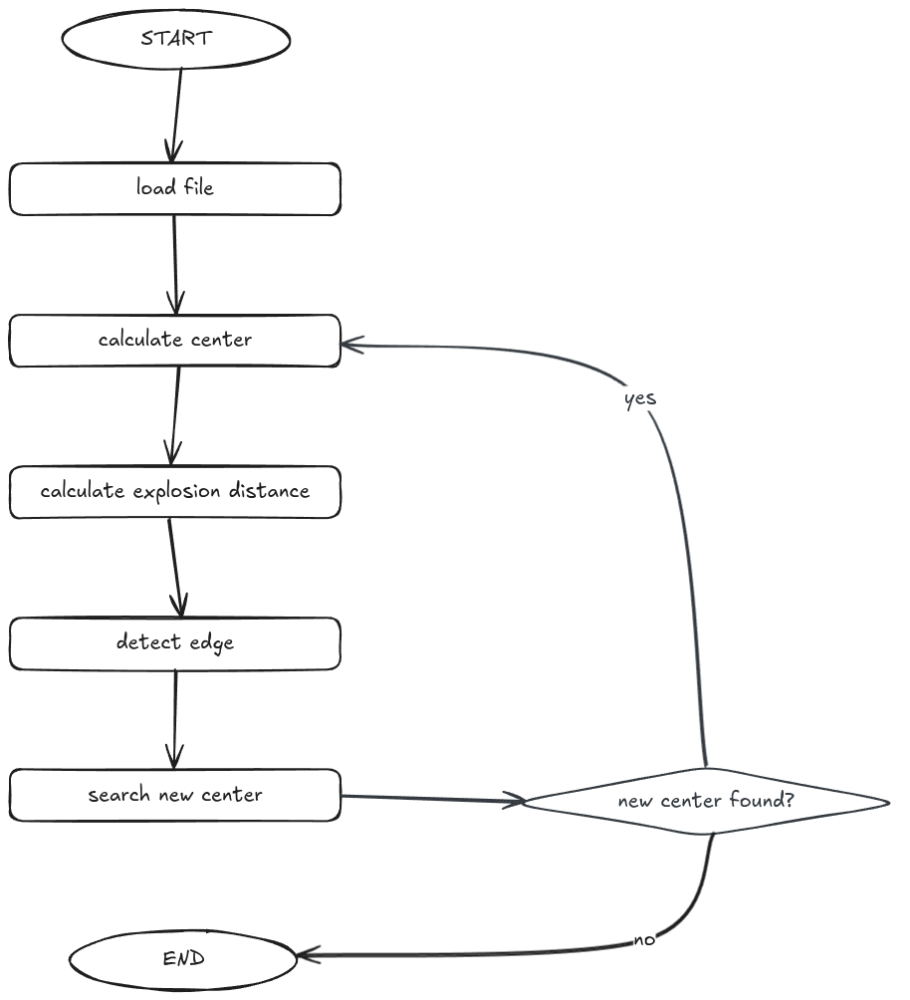

# 0. Main Function

- **FUNCTION**: Convert normal point cloud or mesh into [firework cloud](../object_model/firework_cloud.md).
- **INPUT**: normal point cloud
- **OUTPUT**: firework cloud
- **SUBFUNC**:
    - [load file](1_load_file.md)
    - [calculate center](2_calculate_center.md)
    - [calculate explosion distance](3_calculate_explosion_distance.md)
    - [detect edge](4_detect_edge.md)
    - [search new center](5_search_new_center.md)
- **STRUCTURE**:   
    
